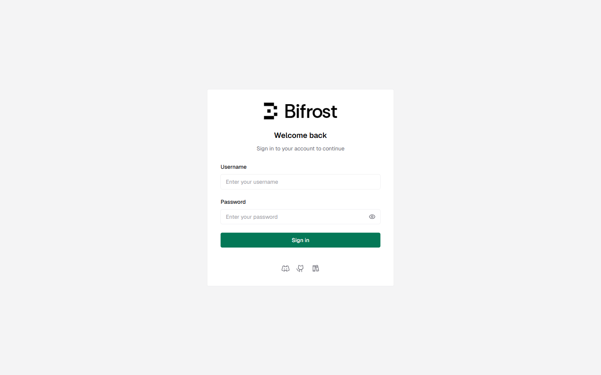
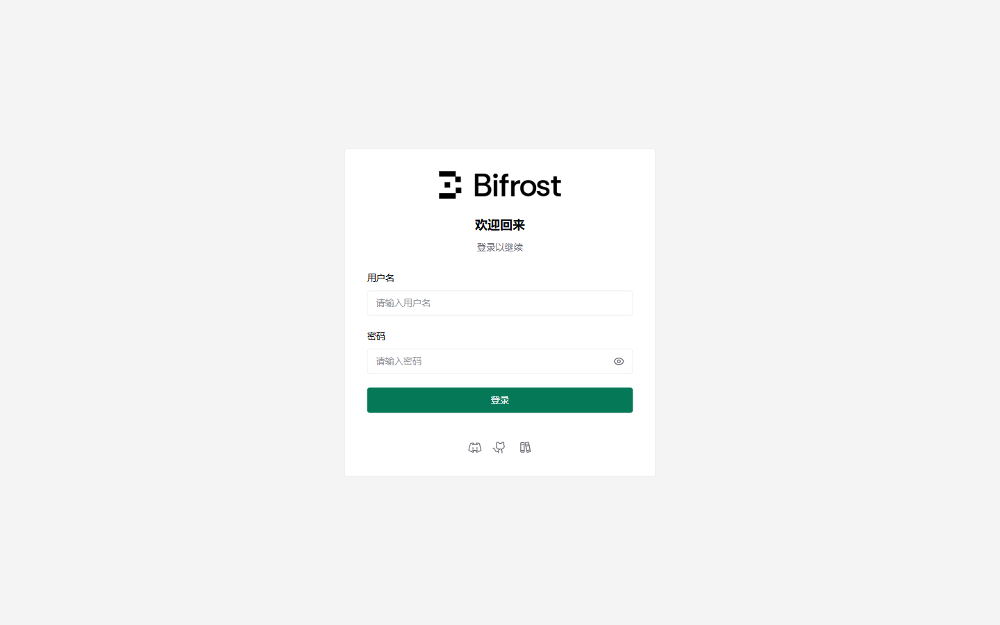

# bifrost-zh — Bifrost 仪表盘汉化

把 [Bifrost](https://github.com/maximhq/bifrost)（LLM 网关）的 Web 仪表盘界面汉化为**简体中文**的
Tampermonkey 用户脚本。纯浏览器侧，只读、零外部依赖、**运行时零网络请求**。

> **适配基准**：在 **Bifrost v2.3.0** 上逐页验证（84 个路由，另加标签页 / 下拉 / 弹窗 / 日历等交互态）。
> 上游升级后若有漏译，欢迎提 issue，或在 `src/dict.json` 补词条后 `python build.py` 重新构建。

| 英文原界面 | 汉化后 |
|---|---|
|  |  |

## 安装

1. 浏览器安装 [Tampermonkey](https://www.tampermonkey.net/)（或 Violentmonkey 等支持 `@grant none` 的管理器）。
2. 打开 [`bifrost-zh.user.js`](bifrost-zh.user.js) 点 Raw 安装；或把全文复制到「新建脚本」里保存。
3. 打开你的 Bifrost 仪表盘，界面即为中文。

> **确认装的是哪一版**：控制台里看 `document.documentElement.dataset.bfZh` 或
> `window.__BIFROST_ZH__.version`，形如 `1.2.0/5411`（版本 / 词典条数）。

## 作用域与逃生口

Bifrost 仪表盘在**根路径、端口任意**，没有可用的窄匹配（`@match` 的端口也不能写 `*`，
Chrome match pattern 不允许，Tampermonkey 会直接判为 "Bad pattern" 拒绝安装）。因此默认匹配
`*://*/*` 加 `localhost` / `127.0.0.1` 正则，再由运行时的**站点指纹**确认（只读页面已有信息，
不发网络请求）：

- 页面 `title` 含 `Bifrost`，或
- 页面挂了 `window.__bifrostBooted`（Bifrost 前端自己的启动标记）

两者都不满足就**静默退出**——不翻译、不写版本标记、不挂 `MutationObserver`、不碰页面。

指纹判错时可强制启用：

- URL 上加参数 `?bifrost-zh=force`，或
- 控制台执行 `localStorage['bifrost-zh-force']='1'` 后刷新

想只在自己的部署上生效，把脚本头的 `@match` 换成你的地址即可。

## 特性

- **精确词典 + 少量正则**：替换 DOM 文本节点与 `placeholder`/`title`/`aria-label`/`alt`，
  词典 5411 条、正则 128 条。
- **随渲染持续生效**：`MutationObserver` 跟踪 React 重渲染，动态内容也翻译。
- **只读**：不改动 Bifrost 本体、不发网络请求、不碰后端数据。
- **完全离线**：词典与模式全部内嵌，不调用任何第三方翻译服务、不申请跨域权限。
- **接近原生中文**：`lang=zh-CN`、为纯拉丁字体补齐中文回退链、把拉丁负字距改回 `normal`。
- **有意保留英文**：产品 / 公司名（OpenAI、Anthropic、Kafka…）、模型名、代码样例、
  单位（`ms`、`tok/s`），以及中文技术圈惯用原词的 `Webhook` / `Token` / `MCP`。

## 构建

产物 `bifrost-zh.user.js` 由 `src/` 合并生成，改词典或模式后必须重新构建：

```bash
python build.py                 # 由 src/ 生成 bifrost-zh.user.js
python build.py --check         # 只校验源文件
```

## 测试

零依赖回归测试（Node 内置模块）：

```bash
node tests/test_translate.mjs   # 210 项，全部通过
```

覆盖词典命中 / 动态模式 / 幂等 / 不误伤、元数据可安装性、离线自足、站点指纹门禁等。

## 与上游的关系

不修改上游源码，只提供前端翻译层。上游 Bifrost 为 [maximhq/bifrost](https://github.com/maximhq/bifrost)。

## License

MIT
